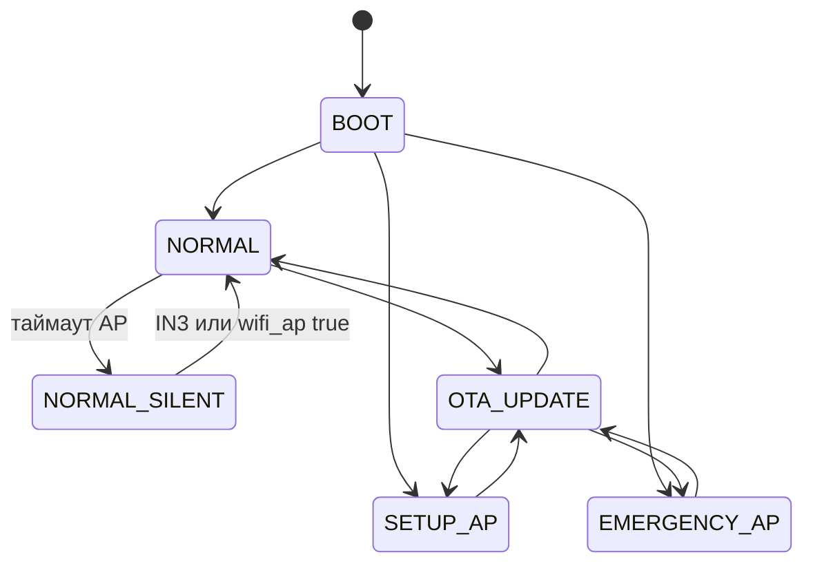
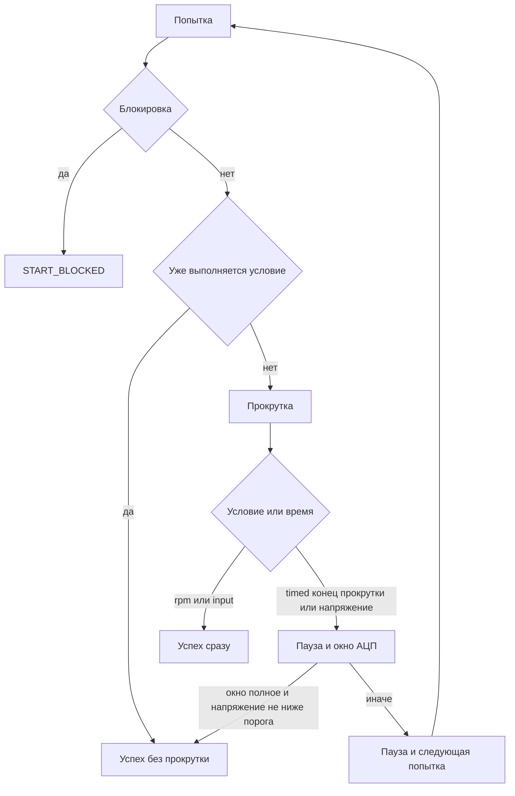

# Чем руководствуется прошивка

Поведение, которое код реально исполняет. Контракты модулей и таблицы AT/MQTT остаются в `docs/modules/`. Сценарии для человека за рулём — в [USAGE.md](USAGE.md).

Источник чисел: [`include/common/Constants.h`](../include/common/Constants.h) и заводской JSON [`include/config/DefaultConfig.h`](../include/config/DefaultConfig.h).

## Режимы

Имена: `boot`, `emergency_ap`, `setup_ap`, `normal`, `normal_silent`, `ota_update`. Пока сохранение настроек просит перезагрузку, UI видит имя `reboot_required`, а сам режим остаётся прежним.

Кто что делает ([`src/core/Core.Modes.cpp`](../src/core/Core.Modes.cpp)):

- `NORMAL` и `NORMAL_SILENT`: программы, реле, триггеры, защита АКБ, термостат, время, GSM/MQTT и входящий DTMF.
- `SETUP_AP`: входы, датчики, флаг двигателя и защита реле. Модем выключен.
- `EMERGENCY_AP`: веб. `relay.update()` не идёт, модем выключен.
- `OTA_UPDATE`: сотовая связь выключена, дальше крутится только обработчик прошивки.

Старт. `setup_required` ведёт в `SETUP_AP` (с завода так и есть). Если загрузка конфига и заводской сброс оба не удались — `EMERGENCY_AP`. Сбой монтирования LittleFS и только что записанные заводские значения дают жёсткую перезагрузку и режим не выбирают.

Тихий режим. Вход из `NORMAL` только когда включён таймаут точки, число секунд больше нуля, веб поднят и сессий UI нет дольше этого срока. С завода таймаут выключен (`ap_timeout_sec` 0). Выход: фронт нажатия IN3 или MQTT `set` `wifi_ap` со значением true. Команда `wifi_ap: false` тихий режим не включает. Из тихого режима прошивку начать нельзя: веба нет. Возврат из OTA — в тот режим, откуда начали загрузку (`NORMAL`, `SETUP_AP` или `EMERGENCY_AP`).

`setup()` вызывает `logger.begin()`, затем `core.begin()`. `loop()` вызывает только `core.update()`.

## Один тик и программы

В `NORMAL` после шагов текущей программы порядок такой: триггеры входов, температурные триггеры, защита АКБ, термостат, обслуживание модема, затем отложенный пуск по DTMF. Каждый удачный `start()` забирает слот у предыдущего. В одном тике побеждает последний удачный пуск. `program_id == 0` программу не запускает.

Передача слота ([`src/program/ProgramExecutor.Core.cpp`](../src/program/ProgramExecutor.Core.cpp)):

- Удача: реле остаются как есть, крутящийся стартер снимается, эпоха голоса или SMS обрывается. `allOff()` нет.
- Неудача (нет файла, пустая программа, шаг не прошёл проверку): `allOff()`, затем завершение прежней программы.
- Обычное завершение реле не гасит.
- `stop()` всегда делает `allOff()` и обрывает эпоху голоса.

Запись на флеш не идёт, пока программа выполняется или OTA держит флеш.

Мгновенный шаг сам вызывает следующий в том же проходе. Шаг с ожиданием (пауза, импульс, запуск, звонок, SMS) останавливает цепочку до следующего тика. В программе не больше 15 шагов.

Проверка шага и при сохранении файла, и при `start()` отвергает одной ошибкой `PROGRAM_INVALID_REF`: неизвестное действие, реле вне K1–K5, любое `RELAY_*` на реле стартера, вход вне IN1–IN3, неизвестный id триггера, пустое SMS. Файл на диске прошивка не «чинит».

### Заводские программы

Пишутся при сбросе программ ([`src/config/Config.Programs.cpp`](../src/config/Config.Programs.cpp)). Лимит — 100 программ (`Limits::MAX_PROGRAMS`).

1. «Запуск» (id 1): K5 вкл, пауза 500 мс, K2 вкл, пауза 5 с, `ENGINE_START`, K1 вкл, пауза 5 с, K5 выкл. Без SMS. K1 и K2 остаются включены.
2. «Стоп» (id 2): K2, K1 и K5 выкл.
3. Служебные id 230–249: все доступные реле (K1/K2/K4/K5, без стартера K3) вкл/выкл; по одному вкл/выкл на K1, K2, K4, K5; SMS; звонок; защита АКБ и термостат вкл/выкл; включение и выключение всех входных и всех температурных триггеров.

С завода в конфиге три выключенных входных триггера (IN1–IN3, `program_id` 0) и три выключенных температурных (T1–T3, порог 0 °C, `above`, `program_id` 0). Пока `program_id` 0, срабатывание программу не запускает.

Имена с завода: K1 «ACC», K2 «зажигание», K3 «стартер», K5 «обход».

### Действия шага

Подписи экрана — в [`data/ui/program-steps.ui.json`](../data/ui/program-steps.ui.json). Исполнение — [`src/program/ProgramExecutor.Execute.cpp`](../src/program/ProgramExecutor.Execute.cpp).

| Действие | Что делает |
|---|---|
| `WAIT` | Держит `ms`, затем следующий шаг |
| `RELAY_ON` / `OFF` / `TOGGLE` | Одно переключение реле K1–K5. Реле стартера запрещено |
| `RELAY_PULSE_ON_OFF_ON` | Вкл, пауза `ms`, выкл, пауза `ms`, вкл |
| `RELAY_PULSE_OFF_ON_OFF` | Выкл, пауза `ms`, вкл, пауза `ms`, выкл |
| `INPUT_ENABLE` / `DISABLE` | Включает или выключает вход только в рантайме |
| `INPUT_TRIGGER_*` / `TEMP_TRIGGER_*` | Включает или выключает защёлку триггера по id. Выключение сбрасывает защёлку. Включение взводит её, чтобы уже истинный уровень не сработал сразу |
| `BATTERY_SAVER_ON` / `OFF`, `THERMOSTAT_ON` / `OFF` | Только рантайм-флаг. Поле `enabled` в конфиге всё равно должно быть истинно |
| `ENGINE_START` | Автомат стартера из `config.vehicle`, не из полей шага |
| `CALL_OWNER` | Звонок на `gsm.owner_phone`. Поле `ms` игнорируется |
| `SMS_OWNER` | SMS на тот же номер, текст шага |

`CALL_OWNER`: гудки до ответа (`+CLCC` со статусом 0), `NO CARRIER`, `BUSY`, `NO ANSWER` или 25 с. Затем `ATH`. Если `ATH` вернул OK, шаг успешен и программа идёт дальше, в том числе после «занято» и «не отвечает». Шаг провален, если набор отклонили, `ATD` не удался или `ATH` не удался. Провал звонка реле не гасит.

`SMS_OWNER`: текст до 64 байт плюс завершающий ноль. Пустой текст и байты `0x1A` / `0x1B` отвергаются. Проверки алфавита GSM-7 нет. Ошибка модема до приглашения `>` приводит к ESC и ожиданию, шаг сразу не кончается.

## Запуск двигателя

Единственный путь к реле стартера — шаг `ENGINE_START`. Алгоритм, вход, окно напряжения, попытки и тайминги берутся из `config.vehicle`. Неизвестное имя шага в `ENGINE_START` не превращается. Веб и MQTT сами реле стартера не включают.

Методы: `timed`, `rpm`, `input`. Неизвестная строка при разборе становится `timed`. Если при загрузке вход старта негоден, метод тоже сбрасывается в `timed`. На загрузке числа зажимаются в диапазон, POST вне диапазона отвергается.

Диапазоны (`StarterLimits`): прокрутка 0,5–30 с (завод 2); потолок 1–30 с (завод 5), прокрутка не длиннее потолка; пауза после прокрутки 2–120 с (завод 10); пауза между попытками 0–600 с (завод 5); попытки 1–5 (завод 3). Пороги напряжения 5–30 В, «заведён» строго выше «заглушен» (завод 13,2 и 12,8). Timed-стартер ориентируется на «заведён»; флаг двигателя — гистерезис обоих порогов.

На любой фазе активная блокировка снимает реле стартера и завершает шаг с `START_BLOCKED`. `start_block_input_id == 0` означает, что блокировки нет. Иначе вход обязан существовать, быть цифровым, включённым в рантайме и логически неактивным. Отсутствующий, выключенный или не цифровой вход запирает шаг. С завода блокировка — IN2. Вход блокировки не может совпадать с входом старта.

Уже выполненное условие до прокрутки — успех, попытка не расходуется. Для всех методов: флаг «двигатель работает» (гистерезис) запрещает прокрутку. Дополнительно для `timed` — полное годное окно не ниже «заведён»; для `rpm` и `input` — само условие.

`timed`, напряжение уже годное, а окно ещё не полное: не ниже «заведён» — ждать, прокрутку не начинать и успех не объявлять; ниже «заведён» — крутить сразу, без полного окна. Нет годного АЦП: ждать паузу после старта плюс 2 с, затем попытка кончается как `NoVoltage`.

Прокрутка идёт до условия (`rpm` / `input`), для `timed` — до длительности прокрутки или раньше, как только полное окно АЦП не ниже «заведён» (двигатель завёлся), и не дольше `starter_max_time_sec`. Условие оборотов или входа — успех сразу, без проверки напряжения. Конец прокрутки по времени или по напряжению: реле стартера выкл, окно АЦП сбрасывается, пауза `wait_after_start_sec`, затем до ~1,2 с на 5 отсчётов. Полное окно и напряжение не ниже «заведён» — успех. Иначе пауза `starter_retry_pause_sec` и следующая попытка. На этой паузе остальные реле программы (зажигание, обход) остаются включёнными. Полный `allOff()` — только когда попытки кончились: `START_FAILED`, в журнале маска реле до выключения. То же `allOff()` при `START_BLOCKED` и обрыве стартера (`RELAY_TIMEOUT`). 
Вход `rpm` на шаге должен быть включённым импульсным входом с `threshold_rpm > 0`. Вход `input` — включённым цифровым. Если к моменту шага источник негоден или `starter_relay_id` плохой, шаг кончается `PROGRAM_INVALID_REF` и `allOff()`.

Обрыв пина стартера во время прокрутки и отказ `on()` дают `RELAY_TIMEOUT` и обрыв шага.

Защита реле отдельно от автомата попыток ([`src/io/RelayController.cpp`](../src/io/RelayController.cpp)):

- Потолок времени включения есть только у реле стартера (`starter_max_time_sec`). Остальные реле без потолка.
- Повторный `on()` уже включённого стартера таймер не продлевает.
- `esp_timer` принудительно снимает пин через потолок плюс 300 мс, даже если цикл застрял.
- Срабатывание защиты ставит `RELAY_TIMEOUT` и запрещает следующий `on()` на `max(пауза повтора, 5 с)`. Исполнитель из-за этого обрывает шаг.
- Смена `starter_relay_id`, пока этот пин включён, откладывается.

Реле активны высоким уровнем (XH-C3F): K1 IO3, K2 IO19, K3 IO18, K4 IO10, K5 IO1.

### Флаг «двигатель работает»

Это не успех шага `ENGINE_START` ([`src/core/Core.Core.cpp`](../src/core/Core.Core.cpp)). Источник `input` берёт `getState(engine_input_id)`: логический уровень или подтверждённые обороты. Любая другая строка, включая `voltage`, смотрит на напряжение с гистерезисом: не ниже «заведён» включает флаг, не выше «заглушен» выключает, полоса держит прежнее значение (`applyEngineRunningHysteresis` в [`include/config/VehicleRules.h`](../include/config/VehicleRules.h)). Негодный АЦП тоже держит прежнее. Стартер перед прокруткой читает этот флаг (не крутит, если истинен); mid-crank и settle timed сравнивают с «заведён». Защита АКБ считает этот флаг признаком, что двигатель уже схватился. С завода источник — напряжение, вход двигателя — IN2.

## Входы, обороты, напряжение

Три входа (XH-C3F): IN1 IO5, IN2 IO4, IN3 IO8 (кнопка платы). Пять реле K1–K5. Три слота DS18B20, 1-Wire IO9. АЦП напряжения — IO0.

Цифровой вход: антидребезг 50 мс. Состояние — сырой уровень совпал с `active_state`. Выключенный в рантайме читается как неактивный. Смена логического состояния пишется в журнал (`active` / `inactive`).

Импульсный вход. Прерывание на каждый фронт пишет метку `micros()` в `RpmEstimator` и не пишет в журнал. Оценка оборотов пишется из `update()`, когда она впервые посчитана и когда уходит от прошлой строки не меньше чем на 50 об/мин. `pulses_per_rev` — число фронтов на оборот, считаются оба фронта. Подтверждение: обороты не ниже `threshold_rpm` непрерывно 100 мс. Порог 0 никогда не подтверждается. Тишина 250 мс обнуляет обороты. Фронты быстрее 12000 об/мин отбрасываются.

С завода ROM слотов — датчики эмулятора стенда: T1 `28:CE:01:00:00:00:00:5F`, T2 `28:CE:02:00:00:00:00:11`, T3 `28:CE:03:00:00:00:00:DC`.

Пробуждение из тихого режима смотрит фронт нажатия IN3 и не зависит от того, включён ли триггер на этом входе. Триггер на IN3 может сработать уже на следующем тике: он смотрит уровень и защёлку фронта.

### Напряжение бортсети

Фильтр АЦП подогнан под то, как напряжение меняется в машине, а не под ШИМ стенда.

| Сценарий | Типичное поведение | Фильтр |
|----------|--------------------|--------|
| Покой / ровная зарядка | почти DC | мёртвая зона 0,10 В — стоим |
| Прокрутка / крупный сброс | скачок ≥0,5 В | commit за 1 тик, затем slew |
| Генератор / нагрузка / график MQTT | ступеньки ≥0,1 В | 2 тика с Δ≥0,10 В — slew (20 В/с вниз, 10 В/с вверх) |
| Шум / ШИМ стенда | <0,1 В | не проходит deadband |

Цепочка: `voltage = raw × adc_voltage_coeff` (завод 0,004). За тик — 32 сырых чтения, медиана из 5, EMA evidence (α=0,50), затем deadband → commit (fast-track ≥0,5 В за 1 тик, иначе 2 тика при ≥0,10 В) → slew. Опрос 200 мс, в простое 400 мс. MQTT status и UART-лог — шаг 0,10 В (`STATUS_VOLTAGE_EPS` / `LOG_BAND_V`).

Температура: сначала MATCH по ROM из слотов конфига (датчик жив, если отвечает READ SCRATCHPAD с верным CRC); незанятые слоты и ROM, которые не ответили — SEARCH на шине. Повторная привязка, если датчиков нет или шина молчит несколько циклов. Опрос раз в 5 с, в простое раз в 15 с. В журнал — первая оценка и каждое отклонение не меньше 0,5 °C.

Сохранение настроек сразу вызывает `DigitalInputs::applyConfig()`: тип, включение и параметры оборотов применяются до перезагрузки. Флаги включения триггеров при этом не перечитываются.

## Триггеры, термостат, защита АКБ

До 8 триггеров входа и 8 температурных. Срабатывание по фронту: один раз, когда условие стало истинным, и снова только после того, как оно побывало ложным. После загрузки и после выхода из OTA защёлки взводятся, чтобы уже истинное условие программу не запустило. Неудачный `start()` защёлку не сбрасывает: битая ссылка не вызывает `allOff()` каждые 50 мс.

Опрос 50 мс. В простое (программа не идёт, а в `NORMAL` ещё и нет сессии UI) — 200 мс.

Входной триггер срабатывает, когда `getState` становится равен «уровень 1 означает логически активен». Уровень 0 — логически неактивен. Заводской уровень — 1.

Температурный триггер срабатывает при пересечении порога. Повторно взводится, только когда значение вернулось за порог на 0,5 °C. `above` — значение строго выше порога, `below` — строго ниже. Любая другая строка не срабатывает никогда. Негодное чтение защёлку не отпускает.

Термостат требует и рантайм-флаг, и `thermostat.enabled`. Нижняя программа запускается, когда температура уходит ниже `lower_threshold`. Верхняя — когда уходит выше `upper_threshold`. Поле `comparison` хранится (с завода `above`) и менеджером не читается. Гистерезис отпускания тот же, 0,5 °C. Оба порога могут сработать в одном проходе; верхний `start()` вытесняет нижний. Датчик ищется по id слота. Негодное чтение защёлки не сбрасывает. С завода: датчик T1, пороги 5 °C и 10 °C, программы 0 (пуск не происходит).

Защита АКБ требует оба флага, рантайм и `battery_saver.enabled`. С завода выключена. Пороги: пуск 11,8 В, обрыв 10,5 В, гистерезис 0,5 В, просадка не короче 180 с, пауза между попытками 1800 с, не больше 3 попыток в сутки. POST требует, чтобы порог пуска был выше порога обрыва.

- Время просадки копится, только пока ни одна программа не идёт. В полосе от порога пуска до порога плюс гистерезис таймер держится, но пуск не происходит. Выше этой полосы таймер сбрасывается.
- Удачный `start()` увеличивает счётчик суток и запоминает время попытки. Неудачный счётчик не увеличивает, но таймер просадки сбрасывает: 180 с нужно набирать снова.
- «Сутки» — местный календарный день, если часы синхронизированы. Иначе отрезок 24 ч от `millis()`. Нулевая метка последней попытки значит, что попыток ещё не было.
- Обрыв: напряжение ниже `voltage_abort_threshold`, идёт программа с этим `program_id`, и текущий шаг не `ENGINE_START`. Если флаг двигателя уже истинен, обрыва нет. После прокрутки обрыв ждёт, пока окно АЦП наберётся заново, и не рвёт по просадке стартера. Сам обрыв — это `stop()`, то есть все реле гаснут.

`enabled` термостата, защиты АКБ и триггеров копируется в рантайм при загрузке и при выходе из OTA. Пороги читаются на каждом `update()`. Сохранение настроек ставит `rebootRequired`.

## Голос, SMS и входящий пуск

На время голоса и SMS MQTT CIP останавливается. Параллельно голос и сокет не живут. Звонок и SMS отменяют идущую синхронизацию времени.

Исходящий звонок: `ATD` на номер владельца, гудки до ответа или 25 с, затем `ATH`. Потолок голосовой эпохи — 60 с.

Входящий звонок берётся, только если GSM в `READY`, телефон владельца и пароль DTMF оба не пустые (с завода оба пустые), и CLIP совпал. Совпадение — последние 10 цифр, поэтому `+7…` и `8…` сходятся. Более короткий номер сравнивается целиком. Чужой CLIP пишется в журнал: трубку не берут и `ATH` не шлют, звонок продолжает звонить.

Пароль сравнивается, как только набрано ровно столько цифр, сколько в нём задано. `#` пароль не заканчивает. `#` или `*` во время пароля кладут трубку. Дальше id программы: от 1 до 255, не больше трёх цифр, конец `#`. Пустой `#`, `*` и четвёртая цифра кладут трубку без пуска.

Флаг пуска ставится в момент принятого `#`, до OK на `ATH`. В том же тике ядро после обслуживания модема забирает флаг и вызывает `start()`. Программа может пойти, пока `ATH` ещё только отправлен. ERROR или таймаут `ATH` гасит флаг, только если ядро его ещё не забрало. Уже начатый пуск не отменяется. Флаг забирается и в `NORMAL`, и в `NORMAL_SILENT`.

Подробности FSM, `CIPRXGET=0` и уровней восстановления — в [modules/gsm.md](modules/gsm.md).

## MQTT

Топики, retain и размеры кадров — в [modules/mqtt.md](modules/mqtt.md). Здесь только решения.

Команды: `run`, `stop`, `list`, `programs`, `status`, `seq`, `set`, `set_time`, `hwmap`, `trigmap`, `reboot`. `programs`, `hwmap` и `trigmap` читаются без учёта регистра и публикуют только свой топик (`programs`, `hwMap`, `trigMap`). Имена `set`: `thermostat`, `battery_saver`, `input`, `trigger`, `temp_trigger`, `wifi_ap`. `reboot` — debug: после ack `202` зовёт `core.reboot()` без финального reply.

Негодный `run` отвечает 422. Код 404 бывает только у `set` на отсутствующий вход или триггер. Код 409 прошивка не шлёт. `stop` отвечает 200, даже если программа не выполняется. Слишком большой payload `/cmd` отбрасывается без ответа. При обрыве живой сессии публикуется retained `online=false`, затем MQTT DISCONNECT, а команды ещё во входной очереди получают 500.

Рождение сессии пытается отправить все три хэша каталога. Неудачная публикация рождение не останавливает. Пропуск неизменного хэша — только в установившемся режиме. Затем полный retained `state`, и когда этот снимок ушёл из очереди — retained `online=true`. Публикации устройства идут с QoS 0. QoS 1 — у LWT, подписки и `/reply`.

Очередь передачи глубиной 3. Новый полный кадр заменяет неотправленный полный кадр или дельту. Каталог ничего не заменяет. Телеметрия не занимает слот, пока в очереди есть командный кадр, и оставляет один слот команде. Поле `seq` в ответе опускается, пока из очереди ещё ничего не уходило. Тела `hwmap`, `trigmap` и списка хэш каталога не обновляют: хэш пишет только публикация самого хэша.

`mqtt.loop()` на READY не вызывается после слива эпохи голоса или SMS и на время тяжёлой синхронизации часов. Первый `CIPSTART` ждёт, пока синхронизация времени после загрузки устоится. Лёгкая проба часов может идти рядом с живым сокетом, но новый `CIPSTART` и `CIPSEND` при этом не стартуют.

Кадры статуса и журнал по SSE уходят, только пока есть живая сессия UI. Закрытие последней сессии закрывает SSE.

## Время

Если в старом `/config.json` секции `time` нет, разбор оставляет синхронизацию выключенной: конструктор `TimeConfig` ставит `enabled` в false, чтобы старый файл внезапно не включил NTP. Заводской JSON секцию содержит и включает её: сервер `ru.pool.ntp.org`, пояс +3, период 6 ч.

## OTA

На входе в режим выполняющаяся программа останавливается, все реле гасятся, рантайм триггеров, защиты АКБ и термостата выключается. Сотовая связь приостановлена. SSE остаётся.

Байты загрузки кладутся в кольцо 4 КБ. HTTP отвечает `{"success":true,"rebooting":true}`, как только приём тела помечен финальным. Запись `Update`, хвост LittleFS, смена слота boot и перезагрузка происходят позже, в `OtaHandler::update` на основном цикле. Если `streamFinish` не удался, перезагрузки нет и устройство возвращается в режим, из которого вошли. Простой загрузки без финала дольше 180 с выходит из OTA. Формат пакета — в [modules/ota.md](modules/ota.md).
