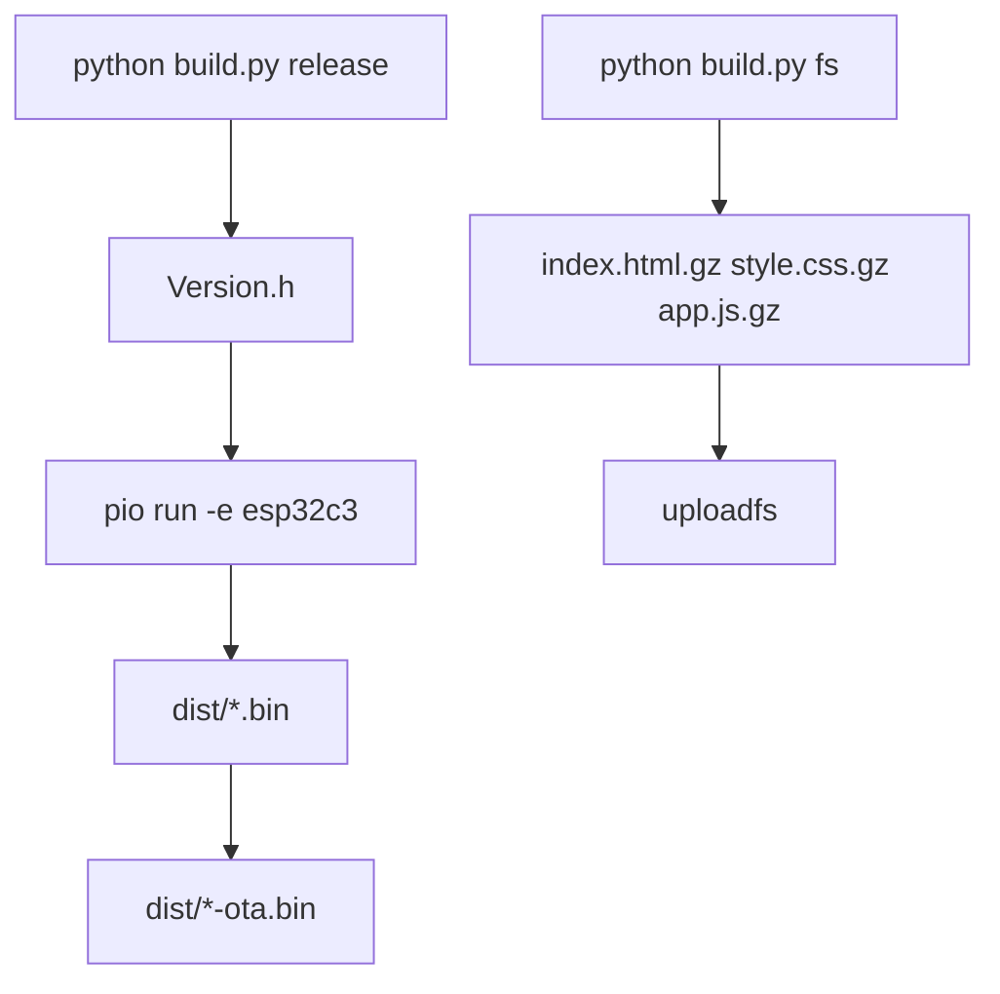

# Сборка, прошивка, LittleFS (ESP32-C3)

Основной путь: [`build.py`](../build.py) и [`platformio.ini`](../platformio.ini), окружение `esp32c3`.



## Требования

- PlatformIO Core
- USB-UART (или USB платы) для загрузки и монитора

## `build.py`

```bash
python build.py --help

python build.py release -u    # прошивка и загрузка
python build.py debug -u      # SERIAL_DEBUG (делит UART с GSM)
python build.py fs            # UI из трёх gzip → LittleFS uploadfs
python build.py release --no-ota
python build.py -c            # очистка
python build.py -m            # монитор
```

Что делает скрипт:

1. Пишет `include/common/Version.h` (не в git)
2. `pio run -e esp32c3` (и по желанию `--target upload`)
3. Копирует `dist/autostart-<ts>-<type>.bin`
4. Собирает OTA (`dist/*-ota.bin`), если нет `--no-ota`
5. `fs`: собирает `index.html.gz`, `style.css.gz` и `app.js.gz` (и схемы), затем `uploadfs`. Если в `data/` есть `config.json`, он попадает в образ LittleFS. OTA-пакет этот файл не включает.

Прямой PlatformIO тоже работает, если не нужны Version.h, OTA и упаковка gzip:

```bash
python -m platformio run -e esp32c3
python -m platformio run -e esp32c3 -t upload
python -m platformio device monitor
```

## LittleFS

- `board_build.filesystem = littlefs`
- Предпочтительно `python build.py fs`, чтобы дерево UI упаковалось правильно (не заливать сырой `data/` без сборки бандла)

## OTA

Аварийный UI лежит в PROGMEM, если ассетов ФС нет (`FallbackWebPage.h`).

Формат пакета (`OtaHandler`):

1. 4 байта LE — размер прошивки
2. тело прошивки
3. необязательный хвост файлов LittleFS (имя, размер, данные)

См. [`modules/ota.md`](modules/ota.md).

## Заметки

- Разделы: [`partitions.csv`](../partitions.csv)
- Пины и запуск: [`HARDWARE.md`](HARDWARE.md)
- Отладочный UART делит SIM800 на GPIO20/21
