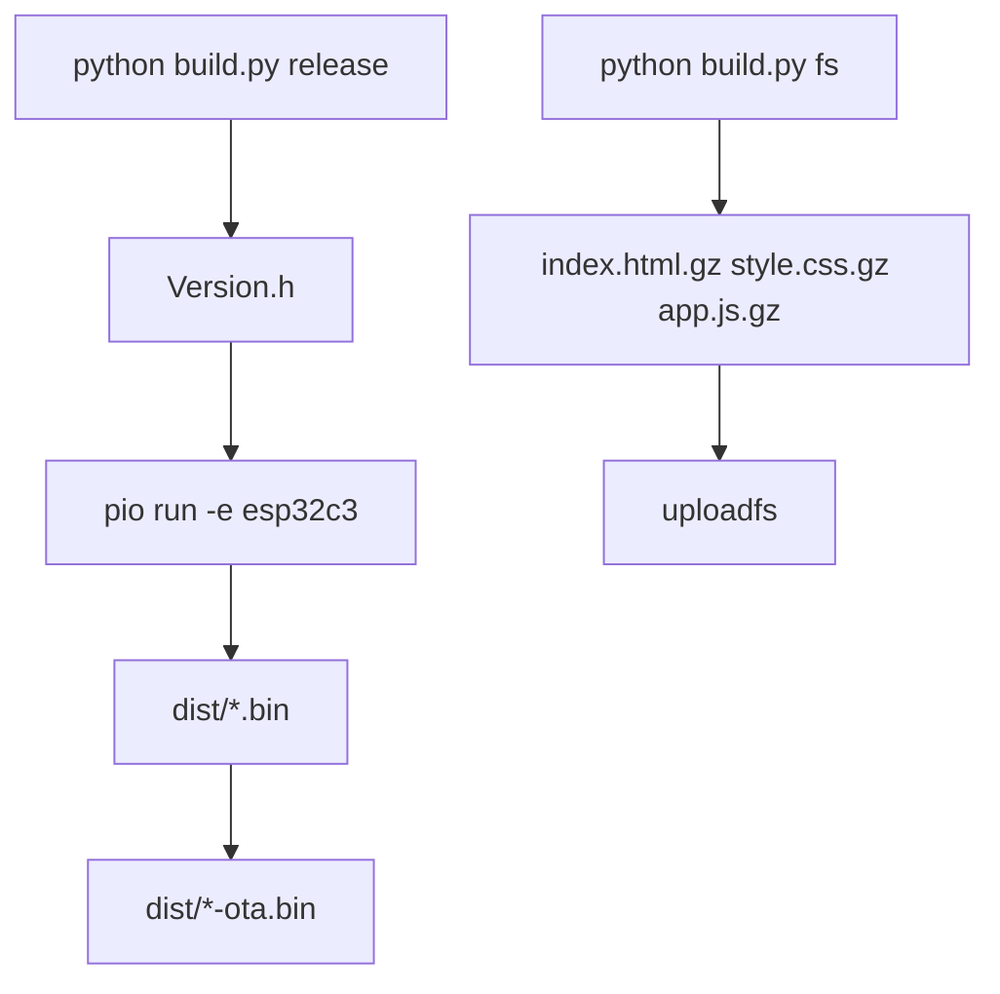

# Build, flash, LittleFS (ESP32-C3)

Primary path: [`build.py`](../build.py) + [`platformio.ini`](../platformio.ini) env `esp32c3`.



## Requirements

- PlatformIO Core
- USB-UART (or board USB) for upload/monitor

## `build.py`

```bash
python build.py --help

python build.py release -u    # firmware + upload
python build.py debug -u      # SERIAL_DEBUG (shares UART with GSM)
python build.py fs            # 3-gzip UI → LittleFS uploadfs
python build.py release --no-ota
python build.py -c            # clean
python build.py -m            # monitor
```

What it does:

1. Writes `include/common/Version.h` (gitignored)
2. `pio run -e esp32c3` (+ optional `--target upload`)
3. Copies `dist/autostart-<ts>-<type>.bin`
4. Packs OTA (`dist/*-ota.bin`) unless `--no-ota`
5. `fs`: builds `index.html.gz` + `style.css.gz` + `app.js.gz` (+ schemas), then `uploadfs`

Direct PlatformIO also works if you do not need Version.h / OTA / gzip packaging:

```bash
python -m platformio run -e esp32c3
python -m platformio run -e esp32c3 -t upload
python -m platformio device monitor
```

## LittleFS

- `board_build.filesystem = littlefs`
- Prefer `python build.py fs` so the UI tree is packed correctly (do not upload raw `data/` without bundling)

## OTA

Recovery UI lives in PROGMEM when FS assets are missing (`FallbackWebPage.h`).

Package format (`OtaHandler`):

1. 4-byte LE firmware size
2. firmware blob
3. optional LittleFS file trail (name/size/payload)

See [`modules/ota.md`](modules/ota.md).

## Notes

- Partitions: [`partitions.csv`](../partitions.csv)
- Pins / bring-up: [`HARDWARE.md`](HARDWARE.md)
- Debug UART shares SIM800 on GPIO20/21
