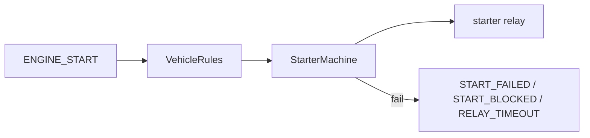

# Продуктовые инварианты (кратко)

Документ для разработчиков и ревьюеров: что **нельзя** «оптимизировать» за счёт исчезновения функций, если об этом явно не договорились.

## Веб в режиме NORMAL

В `CoreMode::NORMAL` подсистема веб-интерфейса (HTTP API + SSE для UI) **должна оставаться активной** настолько, насколько это заложено текущей архитектурой (`WebServer`, режимы ядра).

- Не использовать как план по RAM стратегию вида «в NORMAL не поднимать веб / гасить сервер до следующего SETUP».
- Оптимизации памяти: буферы, пулы, PROGMEM, снижение фрагментации heap, аккуратные лимиты с подтверждением worst-case — без отказа от постоянного доступа к UI в штатной работе.

Подробнее в комментариях к [`include/web/WebServer.h`](../include/web/WebServer.h) и [`include/core/Core.h`](../include/core/Core.h).

## Телефония (звонок / SMS / DTMF)

Классический автозапуск опирается на SIM800 voice/SMS поверх того же UART, что и MQTT:

- Исходящие шаги программ: `CALL_OWNER`, `SMS_OWNER` → `gsm.owner_phone`. `NO CARRIER` / `BUSY` / `NO ANSWER` / 25 с всё равно успех `CALL_OWNER`, если `ATH` вернул OK. Шаг провален, только если набор, сброс или GSM отклонили вызов, и этот провал реле не гасит.
- Входящий звонок: CLIP владельца (последние 10 цифр) и непустой DTMF-пароль фиксированной длины. `#` пароль не заканчивает. Id программы 1–255 и `#`. Флаг пуска ставится в момент `#`, до OK на `ATH`. Пустые пароль или телефон входящий пуск выключают. Чужой CLIP трубку не берёт.
- На время голоса/SMS MQTT CIP **приостанавливается** (exclusive modem epoch); после эпохи MQTT переподключается. Параллельный CIP+voice не поддерживается.
- Входящий `ProgramExecutor::start` забирает слот у текущей (как MQTT `run`): реле при удачной передаче не гасятся, кроме работающего стартера; при неудаче — `allOff()`.

См. [`BEHAVIOR.md`](BEHAVIOR.md), [`modules/gsm.md`](modules/gsm.md), [`modules/program.md`](modules/program.md).

## ENGINE_START

Шаг `ENGINE_START` — единственный путь к реле стартера. Алгоритм, вход, окно напряжения, попытки и тайминги берутся из `config.vehicle`, не из полей шага.

- Timed / RPM / input — три алгоритма в `StarterMachine`.
- Успех timed — полное окно АЦП не ниже `engine_running_voltage_threshold` («заведён») после `wait_after_start_sec`. Тот же порог останавливает прокрутку раньше времени. Флаг двигателя (гистерезис «заведён»/«заглушен») запрещает прокрутку, если уже «работает». Rpm и input успешны по условию, без проверки напряжения.
- Вход блокировки с id 0 блокировку выключает. Иначе негодный или активный вход даёт `START_BLOCKED`. Срез защиты стартера — `RELAY_TIMEOUT` и обрыв шага.
- Неизвестное имя шага не мапится в `ENGINE_START`.
- CALL/SMS шаги и входящий DTMF **не** трогают реле.

Полный автомат — [`BEHAVIOR.md`](BEHAVIOR.md).

