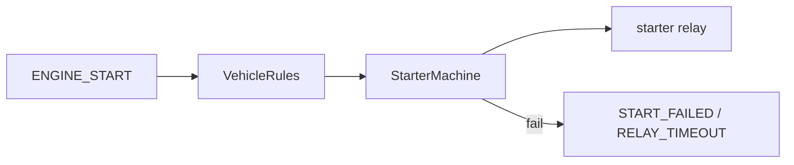

# Продуктовые инварианты (кратко)

Документ для разработчиков и ревьюеров: что **нельзя** «оптимизировать» за счёт исчезновения функций, если об этом явно не договорились.

## Веб в режиме NORMAL

В `CoreMode::NORMAL` подсистема веб-интерфейса (HTTP API + SSE для UI) **должна оставаться активной** настолько, насколько это заложено текущей архитектурой (`WebServer`, режимы ядра).

- Не использовать как план по RAM стратегию вида «в NORMAL не поднимать веб / гасить сервер до следующего SETUP».
- Оптимизации памяти: буферы, пулы, PROGMEM, снижение фрагментации heap, аккуратные лимиты с подтверждением worst-case — без отказа от постоянного доступа к UI в штатной работе.

Подробнее в комментариях к [`include/web/WebServer.h`](../include/web/WebServer.h) и [`include/core/Core.h`](../include/core/Core.h).

## Телефония (звонок / SMS / DTMF)

Классический автозапуск опирается на SIM800 voice/SMS поверх того же UART, что и MQTT:

- Исходящие шаги программ: `CALL_OWNER`, `SMS_OWNER` → `gsm.owner_phone`.
- Входящий звонок: CLIP = owner + DTMF-пароль (`gsm.dtmf_password`) → цифры id программы + `#`.
- На время голоса/SMS MQTT CIP **приостанавливается** (exclusive modem epoch); после эпохи MQTT переподключается. Параллельный CIP+voice не поддерживается.
- Входящий `ProgramExecutor::start` может прервать текущую программу (как MQTT `run`).

См. [`modules/gsm.md`](modules/gsm.md), [`modules/program.md`](modules/program.md).

## ENGINE_START

Шаг `ENGINE_START` — единственный путь к реле стартера. Алгоритм, вход, окно напряжения, попытки и тайминги берутся из `config.vehicle`, не из полей шага.

- Timed / RPM / input — три алгоритма в `StarterMachine`.
- Неизвестное имя шага не мапится в `ENGINE_START`.
- CALL/SMS шаги и входящий DTMF **не** трогают реле.

