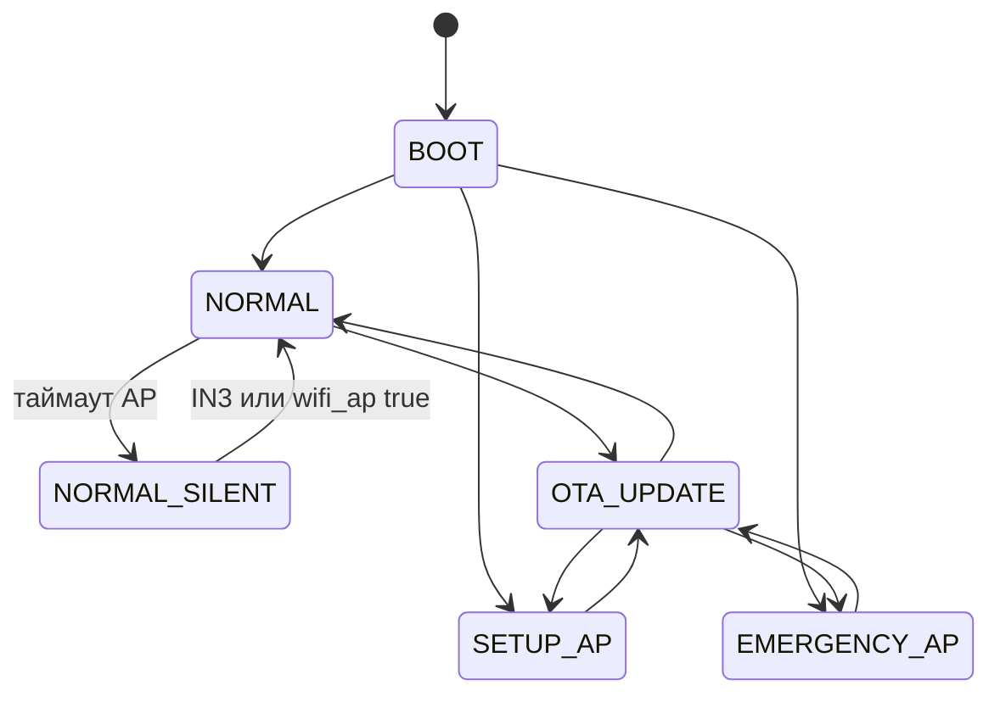

# `core`: orchestration, режимы, периодика

## Роль
`core` — единственная подсистема, которая “видит всю картину” и управляет жизненным циклом устройства.

Контракт:
- `setup()` вызывает `logger.begin()`, затем `core.begin()`;
- `loop()` вызывает `core.update()` и больше ничего.

Полное поведение — [../BEHAVIOR.md](../BEHAVIOR.md).

Основные файлы:
- `include/core/Core.h`
- `src/core/Core.Core.cpp`, `src/core/Core.Modes.cpp`, `src/core/Core.Timing.cpp`, `src/core/Core.Diagnostics.cpp`
- `include/core/ModeManager.h`, `src/core/ModeManager.cpp`
- internal хранилище: `src/core/internal/CorePrivate.h`

## Обязанности `Core`
- инициализация подсистем (FS, config, IO, managers);
- выбор стартового режима (NORMAL/SETUP_AP/EMERGENCY_AP);
- единый “тик” системы (`update()`): watchdog, периодика, обработка текущего режима;
- координация deferred flash операций (через web/fs) так, чтобы они не пересекались с выполнением программ.

## Режимы (`CoreMode`)
Режимы определены в `include/common/Constants.h`:
- `BOOT`
- `EMERGENCY_AP`
- `SETUP_AP`
- `NORMAL`
- `NORMAL_SILENT`
- `OTA_UPDATE`

`ModeManager` отвечает за enter/exit и включение подсистем (web/ota), а доменная логика и hot-path update’ы живут в
`Core::handle*()`.

Кто живёт в режиме:

- `NORMAL` / `NORMAL_SILENT`: программы, триггеры, защита АКБ, термостат, время, GSM/MQTT и DTMF. Silent только без SoftAP. Вход в silent — таймаут AP при нуле сессий UI (`ap_timeout_enabled` и секунды > 0; с завода выключен). Выход: IN3 или MQTT `set` `wifi_ap: true`. Из silent OTA не начинается.
- `SETUP_AP`: входы, датчики, флаг двигателя и защита реле. Модем выключен.
- `EMERGENCY_AP`: веб, модем выключен, `relay.update()` не идёт.
- Сбой монтирования LittleFS и свежая запись заводских значений дают hard restart, режим не выбирается.
- OTA входит из `NORMAL`, `SETUP_AP` или `EMERGENCY_AP` и возвращается туда же. На enter гасятся programs/relays и runtime triggers/battery/thermostat.

В одном тике `NORMAL` после шагов программы: триггеры входов, температурные, защита АКБ, термостат, модем, затем отложенный DTMF.

## Триггеры, термостат, защита АКБ

На этот раздел ссылается `include/core/TriggerRules.h`.

- Входной триггер — фронт уровня `trigger_level` (1 = логически активен). `program_id == 0` не стартует. После boot и выхода из OTA защёлка взводится, уже истинный уровень пуск не даёт.
- Температура и термостат отпускают защёлку с гистерезисом 0,5 °C. Нижний порог термостата всегда «ниже», верхний всегда «выше». Поле `comparison` хранится и не читается.
- Защита АКБ копит просадку, только пока программа не идёт. Обрывает свою программу (не шаг `ENGINE_START`), если флаг двигателя ещё ложен, и после прокрутки ждёт новое окно АЦП. Сутки — календарный день при синхронизированных часах, иначе 24 ч от `millis()`.

## Важные инварианты
- `Core::update()` должен быть неблокирующим и вызываться часто.
- Долгие операции обязаны делать time slicing:
  - `Core::cooperate()` — throttled `yield()` для FreeRTOS/lwIP fairness
  - `Core::feedWatchdog()` — для длительных операций, где частый `yield()` вреден

## “Runtime knobs”
`Core` предоставляет узкие методы для рантайм-управления менеджерами (например включить/выключить термостат/триггеры).
Правило: такие методы должны **делегировать** в соответствующий manager и не разрастаться в бизнес-логику.

