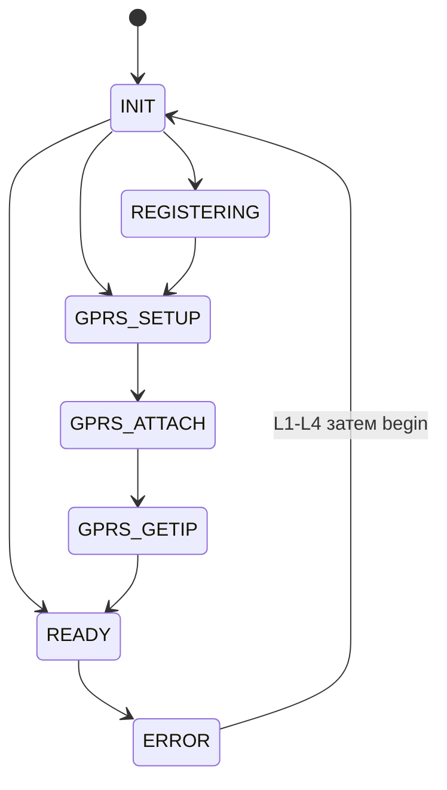

# `gsm`: SIM800 FSM, recovery, voice/SMS, time sync

Транспорт AT/TCP — в [`modem.md`](modem.md). MQTT поверх `Client` — в [`mqtt.md`](mqtt.md).

## Роль

Подсистема GSM поднимает сотовую связь и выдаёт сетевой `Client` для MQTT:

- управление модемом через AT (FSM и очередь команд);
- обработку URC;
- TCP transport поверх SIM800 в режиме `CIPMUX=0`.

Основные файлы:

- `include/gsm/GsmController.h` + `src/gsm/GsmController.*.cpp`
- `include/gsm/GsmModemStack.h` (композиция UART + AT session + TCP transport)
- `include/modem/*` + `src/modem/*` — `AtSession`, `ModemUart`, `Sim800TcpTransport`, адаптер `Sim800ClientAdapter : public Client`

## Контракт (инварианты)

### 1) Единый AT pipeline

- Все AT-команды идут через `AtSession` и `ModemUart`.
- Прямые `Serial.flush()` в прикладной логике не использовать: риск WDT и потери прогресса RX. Для дождаться TX (смена baud / IPR NV) — `ModemUart::flushTx()`.

### 2) FSM GSM

`GsmController` работает как конечный автомат:

- `INIT` может перейти сразу в `REGISTERING`, `GPRS_SETUP` или `READY` после resume-опроса (сеть и bearer уже в рабочем состоянии), иначе — цепочка `REGISTERING` → `GPRS_SETUP` → … → `READY` как ниже.
- Типичный cold path после INIT: `REGISTERING` → `GPRS_SETUP` → `GPRS_ATTACH` → `GPRS_GETIP` → `READY`
- **Warm modem (ребут только ESP):** contact (`AT`/`AT+CGMI`) + status probe (`CREG`/`CGATT`/`SAPBR=2,1`) — без `CFUN`, без повторного open bearer если SAPBR **status=1** и IP ≠ `0.0.0.0` **и** `gsm.apn*` совпадает с последним GPRS_SETUP. Иначе — `GPRS_SETUP` (Contype/APN/USER/PWD). `GPRS_ATTACH` тоже status-first: сначала `SAPBR=2,1`, open `SAPBR=1,1` только если usable bearer нет (`1,3,"0.0.0.0"` не считается up); при ERROR open — повторный probe (часто bearer уже открыт). Смена `apn*` на READY → reattach через `GPRS_SETUP`.
- `ERROR` — восстановление с эскалацией (см. ниже)

### 2а) UART: гипотеза скорости и поиск baud

Параметры и таймеры задаются только в [`include/common/Constants.h`](../../include/common/Constants.h), `namespace Gsm` (например `UART_BAUD`, `POST_BOOT_QUIET_MS`, `PRE_CFUN_AFTER_MS`, `POST_CFUN_QUIET_MS`, `POST_CFUN_RETRY_MS`, `BAUD_SEARCH_ROUND_COOLDOWN_MS`, `MODEM_ID_VERIFY_TIMEOUT_MS`, подстрока `MODEM_VERIFY_MANUFACTURER_SUBSTR` для `AT+CGMI`).

Краткая политика (cold-path):

1. В `begin()` MCU открывает UART на **`Gsm::UART_BAUD`** с пинами `Pin::GSM_RX`/`GSM_TX` (через `ModemUart::begin`), без синхронного autobaud.
2. Quiet **`POST_BOOT_QUIET_MS`**, затем hypothesis: **`AT` → OK** и **`AT+CGMI`** с производителем (`SIMCOM` по умолчанию). Между неудачными hypothesis-попытками — **`HYP_RETRY_GAP_MS`**.
3. Если за **`PRE_CFUN_AFTER_MS`** контакта нет — один best-effort **`AT+CFUN=1,1`** на `UART_BAUD`, quiet **`POST_CFUN_QUIET_MS`**, повтор hypothesis (**`POST_CFUN_RETRY_MS`**). CFUN на чужом baud может не дойти — это ожидаемо.
4. Если после PreCfun контакта всё ещё нет — **асинхронный baud search** по таблице кандидатов (старт со следующего после `UART_BAUD`); между полными неудачными проходами — **`BAUD_SEARCH_ROUND_COOLDOWN_MS`**, один содержательный шаг за тик (`update`).
5. После успешного подтверждения — **`AT+IPR?`**, при расхождении с `UART_BAUD` — **`AT+IPR=`** и **`AT&W`** (NV), **без** ключей baud в `config.json`.

Дополнительно:

- Успешное подтверждение **липнет** до `stop()` (`_verifiedModemContactSinceStop`). После soft-reboot модема (PreCfun / UI / ERROR L4) sticky verify снимается (`gsmNoteModemSoftReboot`), чтобы PreCfun/search снова были возможны.
- Рутиновый CFUN после каждого успешного канала **не** выполняется; CFUN — PreCfun (один раз за цикл) и тяжёлый recovery L4 / UI reboot.

### 3) SIM800 TCP (URC-first)

- Завершение connect/close/send — по URC: точный `CLOSED`, `CONNECT OK` / `CONNECT FAIL`, `SEND OK` / `SEND FAIL`. Голый `ERROR` **не** рвёт TCP (его обрабатывает `AtSession`; иначе GSM AT на том же UART ломал бы сокет).
- **Send-epoch:** с enqueue `CIPSEND` до `SEND OK`/`SEND FAIL`/watchdog держатся `_sendInProgress` + `_modemTxLocked` (даже когда `AtSession` уже Idle после `>`). `CIPSTART` и GSM diag (`CSQ`/`COPS`) запрещены, пока `isTcpEpochBusy()` / сокет up. MQTT Ctrl/`last_err` confirm смотрят `tcpEpochBusy()` (не любой CSQ AT). Полный `isBusBusy()` (= epoch ∨ `AtSession::isBusy`) — для reattach/drain. `stop()` всегда зовёт `endSendEpoch_()` — иначе mid-CIPSEND abort оставлял `_modemTxLocked` и блокировал reconnect.
- Перед **первым** `CIPSTART` после `Sim800TcpTransport::reset()` — один `AT+CIPSHUT` (тёплый модем после ребута ESP). Cooldown `CONNECT_RETRY_COOLDOWN_MS` между попытками.
- `Client::connect` — **неблокирующий** kick `CIPSTART` (без wall-clock wait); иначе SoftAP/IWDT.
- Watchdogs: connect (`CONNECT_WATCHDOG_MS`) сбрасывает залипший `_connecting`; send (`SEND_WATCHDOG_MS`) после `CIPSEND`/`>` без `SEND OK` — end send-epoch + CIPSHUT recover.
- **`SEND FAIL` / CIPSEND accept fail / CIPSTART accept fail** — fail-closed: session down + CIPSHUT recover (как send WD). MQTT RX всегда drain (mid-CIPSEND +IPD безопасен; post-send quiet нет).
- После `STACK_RECOVER_REATTACH_THRESHOLD` CIPSHUT-recover без успешного `CONNECT OK` — `needsBearerReattach` → GSM `requestReattach` (status-first `SAPBR=2,1`).
- Единый owner `GsmController::drainAtResult_()` (только из `update` и cooperate-pump): `takeResult` → TCP CIP* `consumeAtResult`, иначе GSM await absorb. `Sim800TcpTransport::tick` **не** вызывает `takeResult` (иначе non-CIP OK съедался бы мимо GSM).
- RX: **`AT+CIPRXGET=0` → `AT+CIPHEAD=1` → `AT+CIPMUX=0`**. `CIPHEAD=1` обязателен: без него inbound TCP сырой и **дропается mid-CIPSEND** (`discardingTcpPayload_`) → обрезанный MQTT PUBLISH. Флаги ставятся только после **OK** на все три команды; `CIPSTART` — только после подтверждённого `CIPHEAD`. После `CIPSHUT` конфиг сбрасывается и переигрывается.
- **CIPSEND payload TX:** `ModemUart::writeBytes` пишет чанками по 32 байта с `pollRx()` между ними — иначе длинный status full (~400B) забивает HW RX FIFO и режет хвост `+IPD` (`rx_incomplete have≪need`).
- **CIPSEND vs +IPD:** `startSend_` не стартует, пока `_ipState != Idle`; MQTT Tele не flush'ится, пока в FSM собирается валидный неполный inbound кадр.
- Инвариант `onByte`: пока `_ipState != Idle`, raw CRLF-sniffer не трогает байт; после конца `+IPD` payload сбрасывается `_rawLineLen`; последний payload-байт всегда `return` (без fall-through).
- Payload внутри `+IPD` — **бинарный**; на время тела `ModemUart` в `dataMode` (без line-framing URC).
- **Selective discard mid-CIPSEND:** только non-`+IPD` путь; framed `ReadData` принимается (CONNACK/SUBACK/PINGRESP mid-send).
- При `rx_incomplete`: hex головы MQTT + `[Sim800Tcp] RX forensic` (`ipState`/`ipLen`/`ipRead`/send-epoch) + SoftAP UI count.

### 3а) CellularCore glue

- После первого `service()` — settle **`Gsm::POST_BOOT_SETTLE_MS` (20 s)** до `gsm.begin()`.
- `mqtt.loop()` на обычной сессии READY крутится и во время CIPSEND. Он не вызывается после слива эпохи голоса/SMS и на время тяжёлой синхронизации часов. Первый `CIPSTART` ждёт, пока синхронизация после загрузки устоится. Reattach не блокируется только из‑за mid-send.
- Hypothesis `AT`/`CGMI`: пауза **`HYP_RETRY_GAP_MS`** между повторами.
- **Voice/SMS exclusive epoch:** пока `modemServiceEpochBusy()`, MQTT не стартует и не переподключается; при `serviceEpochNeedsMqttDrain()` — `drainMqttDisconnect_`. Эпоху обрывают `ProgramExecutor::stop` и передача слота `start()`. `ctrlPlaneBusy` = TCP-эпоха ∨ любая синхронизация времени (включая CCLK-lite) ∨ voice/SMS, плюс команда в полёте и ожидание QoS1 PUBACK.
- **Time sync:** CCLK-lite при живом MQTT; heavy cascade после drain (`CIPSHUT`/`TIMESHUT` → CIPGSMLOC → CNTP). Тяжёлая синхронизация сливает MQTT так же, как голос. Reattach откладывается, пока heavy cascade busy. Голос и SMS отменяют идущий каскад времени.

### 3б) Voice / SMS / inbound DTMF

Файлы: `src/gsm/GsmController.Voice.cpp`, URC в `GsmController.Urc.cpp`, init `AT+CLIP=1` / `AT+DDET=1` / `AT+CMGF=1`.

- **Исходящие:** `requestCallOwner()` → `ATDphone;`, гудки до `+CLCC` stat 0 или 25 с, затем `ATH`. `requestSmsOwner(text)` → `AT+CMGF=1`, затем `AT+CMGS` + тело + Ctrl+Z. Приглашение `>` — до 10 с, `OK` после Ctrl+Z — до 60 с. `+CMS ERROR` / `ERROR` до `>` шлёт ESC и ждёт, шаг сразу не кончается. Голосовой потолок 60 с на фазы приёма SMS не действует; он ещё действует, пока MQTT сливается и идёт `StopTcp`, до `AT+CMGF`.
- **Входящие:** `RING`/`+CLIP`. Пустые `owner_phone` или `dtmf_password` звонок не берут. Совпадение — последние 10 цифр (короче — целиком). Чужой CLIP пишется в журнал, `ATH` не шлётся, гудки продолжаются. Совпавший номер: слив MQTT → `ATA`. Пароль сравнивается, как только набрано ровно столько цифр, сколько в нём задано; `#` и `*` на этом этапе кладут трубку. Id 1–255, не больше 3 цифр, конец `#`. Флаг пуска ставится в момент принятого `#`, до OK на `ATH`. Ядро в том же тике может вызвать `start()`, пока `ATH` ещё только в очереди. ERROR или таймаут `ATH` гасит флаг, только если его ещё не забрали.
- Несовпадение пароля, пустой `#`, `*` и четвёртая цифра id кладут трубку без пуска.
- После звонка GPRS/MQTT обычно переподключается (ожидаемо).

Полевой чеклист: сценарии **8–10** в [`gsm_mqtt_field_log.md`](gsm_mqtt_field_log.md).

### 4) MQTT поверх `Client`

MQTT реализован **в прошивке** как неблокирующий `MqttFsmClient` (см. [`mqtt.md`](mqtt.md)), а не внешней библиотекой с долгими блокирующими `read()`.

Инвариант: любой код, который ждёт данные от модема, обязан регулярно прокачивать UART/URC и отдавать время сети:

- `ModemUart.pollRx()` (по контракту стека);
- `Sim800TcpTransport.tick(millis())`;
- при необходимости `yield()`.

Это обеспечивается через `PumpFn` в `Sim800ClientAdapter`.

## Политика восстановления (уровни)

От дешёвого к дорогому в `handleError` (ERROR FSM):

- **L1**: restart FSM (`begin` после cooldown)
- **L2**: сброс IP-стека (`CIPSHUT`), wait bus idle
- **L3**: bearer reset (`SAPBR=0,1`), wait result
- **L4**: модемный reset (`CFUN=1,1`), затем `gsmNoteModemSoftReboot`

После `ERROR_RECOVERY_MAX_CYCLES` (3) полных проходов — `GSM_NO_RESPONSE`, пауза `ERROR_RECOVERY_EXHAUSTED_MS` (5 мин), затем счётчик циклов обнуляется и три цикла начинаются снова. Это не один дополнительный медленный круг. `GSM_NO_RESPONSE` снимается на следующем READY. Каждый из L1–L4 ставит `_restartPending` и уходит в `begin()` → INIT, а не остаётся в ERROR.

Паузы: L1 — `ERROR_RECOVERY_DELAY_MS` (30 с), L2 и L3 — `ERROR_RECOVERY_COOLDOWN_MS` (2 с), L4 — тишина после `CFUN` (`POST_CFUN_QUIET_MS`, 20 с). Если подъём застрял дольше 5 мин и уровень ещё ниже 2, L1 пропускается.

На READY отдельно: TCP reconnect (MQTT), reattach с backoff. Ступени 5, 10, 20, 40, 80, 160 с. Потолок константы 180 с на этой лестнице не достигается. Если BER уже прочитан и RSSI ниже 6 или равен 99, пол паузы — 60 с. Backoff **не** сбрасывается на каждом входе в READY — только после стабильной MQTT-сессии (`clearReattachBackoff`). Несовпадение APN ведёт в `GPRS_SETUP`, иначе reattach идёт в `GPRS_ATTACH`. PDP DEACT / CLOSED-threshold идут через тот же `_reattachRequested` + cooldown. Перед уходом с READY: `tcp.stop` и ожидание idle AT bus; `CellularCore` дренирует MQTT как при `suspend`.

CSQ/COPS на READY — только при `!tcpSocketActive()` (не поверх живого MQTT CIP).

## Диагностика

### Политика логирования (SSE)

Каждая строка `logger.log` / `logSerialOnly` начинается с префикса **`[Nms]`** (`millis()`), затем тег модуля.

**Куда пишется:** отладка (`SERIAL_DEBUG`) — SSE и UART; выпуск — только SSE.

**Всегда в потоке** (нарратив «что делает система»): смены состояний FSM (`changeState`), `begin()`/`stop()`, успешное завершение INIT (`INIT OK -> …`), поиск скорости (старт раунда / лимит раундов), ошибки AT и восстановление (уровни L1–L4), переподключение и пауза, решения пользователя (перезагрузка модема), редкие события READY (серия PDP/TCP). Успешные промежуточные шаги подъёма (например только что выполнен SAPBR) **не** дублируются строками — их видно по переходу состояния.

**Зеркало текста UART (`ModemUart`):** весь текстовый обмен MCU↔модем через `logger.log` — `[AT] >> command` на `writeLine`, `[AT] << line` на каждую собранную RX-строку и одиночный `>`. Тело **`CIPSEND`** (`writeBytes`) и байты в **`dataMode` (`+IPD`)** не логируются. `AtSession` дополнительно пишет только `[AT] << TIMEOUT for …` (ответа на проводе нет).

**Тихий парсинг URC:** `+CREG`/`+CGATT` обновляют состояние без спама. **`+CSQ`** логируется только при заметном изменении RSSI (порог `Gsm::URC_RSSI_LOG_DELTA` в [`Constants.h`](../../include/common/Constants.h)); **`+COPS`** — только при смене строки оператора. (Сами URC-строки при этом уже видны в AT mirror.)

**TCP (`Sim800TcpTransport`):** подключение, обрыв и ошибка приёма — короткие фиксированные строки (без периодического сердцебиения `TCP: connected=1`). Подробности (**`+IPD`**, «CIPSTART принят») включаются только в сборке **`SERIAL_DEBUG`** или если **`Sim800Tcp::TCP_VERBOSE_LOG`** в `Constants.h` равен `true`.

### Логи и Serial monitor

- Ключевые логи — редкие, событийные (смена состояния, итоги TCP up/down), плюс AT wire mirror в SSE.
- Если модем делит **UART0 (`Serial`)** с USB-UART адаптером, в монитор могут попадать произвольные байты MQTT (`CIPSEND`), не интерпретируйте их как текстовые логи прошивки.

Предпочтительно: прикладной лог через UI/SSE; низкий уровень — структурные сообщения вида `[AT]`, `[Sim800Tcp]`, `[GsmController]`.

### Антишторм при переподключении

- Повторы «сбои подключения MQTT → переподключение GSM» должны быть ограничены по частоте (не каждый тик цикла).
- Частые куски RX (хвост кольца `GsmController`) — `logSerialOnly`. Зеркало текста AT идёт в SSE; мягкая очередь `SSE_SOFT_QUEUE_MAX=20` и жёсткая `SSE_MAX_QUEUED_MESSAGES=21` (1 место в резерве): при переполнении мягкой очереди копится счётчик, затем `[SSE] dropped N log messages` через резервный слот.
- Куча: периодический снимок не чаще `Timing::HEAP_SNAPSHOT_INTERVAL_MS` (5 мин) и только при сдвиге ≥ `HEAP_SNAPSHOT_DELTA_BYTES`; при деградации (`mqtt_connect_fail`, OTA/режим, `gsm_ready`) — помеченный `Core::logHeapSnapshot`.
- Исходящий MQTT: `[MqttClient] pub online true`, `pub state full seq=… bytes=…` (или delta), без потока PING и SEND OK.

### Сценарии проверки

**1) Проверка приёма HTTP**

- Цель: убедиться, что входящие байты проходят независимо от MQTT.
- Поднять GSM до `READY`, выполнить разовый TCP (HTTP GET на `1.1.1.1:80`).
- Ожидание: входящие байты видны как `+IPD` после `CIPRXGET=0`. Отдельного чтения через `CIPRXGET` нет.

**2) Рукопожатие MQTT**

- После паузы (`POST_BOOT_SETTLE_MS`) и GSM READY: TCP даёт `CONNECT OK`, затем успешный MQTT CONNECT (`CONNACK`).
- Нет шторма `CIPSTART` во время `CIPSEND` и между `>` и `SEND OK`.
- Ожидание журнала: `connected. subscription=` после подписки.
- После SUBACK и трёх хэшей каталога: `pub state full`, затем `pub online true`. Дальше периодически delta или пропуск.

**3) UI при SoftAP**

- SoftAP UI и GSM/MQTT сосуществуют на ESP32-C3.
- Cellular suspend только в SETUP/EMERGENCY AP и `OTA_UPDATE` (не при SoftAP down в NORMAL).
- Полный JSON status уходит без Instruction fault / IWDT.
- Ожидание: в панели виден живой `gsmState` во время загрузки UI (без `/ui/ready`).

**4) Уход из READY / передача переподключения**

- Симулировать серию сбоев MQTT ≥3 или PDP DEACT.
- Ожидание: CIPCLOSE до SAPBR; `GSM left READY — flushing MQTT`; нет шторма очереди AT.
- Повторные сбои: `reconnect (…) pause=%us rssi=%d`; после устойчивого Connected пауза сбрасывается.

**5) last_err delivery**

- Ввести ошибку (например MQTT disconnect), дождаться status с ключом `err`.
- Оборвать TCP до SEND OK: `err` должен появиться снова после reconnect (не «съеден» ранним markDelivered).

**6) Шлюз подтверждения команды**

- При загруженном Ctrl: команда без успешной постановки 202 не должна исполняться (`command not queued (ack busy)`).
- При живой сессии: `run` даёт 202, затем финал 200/500.

**7) Потолок поиска скорости**

- Модем на неверной скорости или без ответа: после `BAUD_SEARCH_MAX_PASSES` — ERROR и `GSM_NO_RESPONSE`, не бесконечный поиск.

Полевой журнал (pass/fail на железе): [`gsm_mqtt_field_log.md`](gsm_mqtt_field_log.md).
