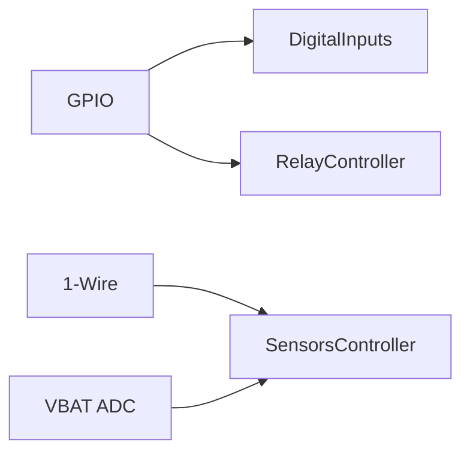

# `io`: входы, реле, сенсоры

## Роль
`io` — hot-path подсистема, которая взаимодействует с “железом”:
- цифровые входы (антидребезг, pulse counter)
- реле
- температурные датчики DS18B20 + измерение напряжения (ADC)

Основные файлы:
- `include/io/DigitalInputs.h` + `src/io/DigitalInputs.cpp`
- `include/io/RelayController.h` + `src/io/RelayController.cpp`
- `include/io/SensorsController.h` + `src/io/SensorsController.cpp`
- hardware map: `include/common/Pins.h`

## Инварианты
- `update()` должен быть быстрым и без heap аллокаций.
- ISR импульсного входа на каждый фронт `CHANGE` пишет метку `micros()` в `RpmEstimator`. Журнала в ISR нет. `pulses_per_rev` — фронты на оборот.
- Все структуры фиксированного размера (`HardwareLimits::*`).

Пять реле K1–K5, активный высокий уровень. Три входа IN1–IN3. Цифровой вход: антидребезг 50 мс и `active_state`; выключенный читается как неактивный. `getState` импульсного входа истинен, когда обороты не ниже порога 100 мс подряд. Потолок времени включения есть только у стартера (`starter_max_time_sec`), плюс аппаратный съём через 300 мс. После срабатывания защиты следующий `on()` запрещён на `max(пауза повтора, 5 с)`. Повторный `on()` уже включённого стартера таймер не продлевает.

Подробности — [../BEHAVIOR.md](../BEHAVIOR.md).

## Напряжение (`SensorsController`)

Цель фильтра — пропускать события бортсети и глушить шум стенда/АЦП.

| Сценарий | Масштаб времени | Действие фильтра |
|----------|-----------------|------------------|
| Покой | DC, без крупной дрожи | \|evidence − выход\| < 0,20 В → не двигаем |
| Скачок ≥0,7 В | стартер, ручной шаг | commit за 1 тик, затем slew |
| Плавное событие | зарядка, нагрузка, `vbat` | 2 тика \|Δ\| ≥ 0,30 В → slew (20 В/с вниз / 10 В/с вверх) |
| ШИМ стенда | остаток ~±0,2 В | evidence-EMA + deadband отсекают |

Реализация (`src/io/SensorsController.cpp`, `Adc::*` в `Constants.h`):
1. 32 сырых `analogRead` → среднее;
2. медиана из 5 тиков;
3. EMA evidence (α=0,50); deadband/commit по ней, не по одному тику;
4. асимметричный slew;
5. `resetVoltageWindow()` сбрасывает только кольцо доверия стартера, не `_filtVolts` и не evidence.

Стендовый эмулятор (CarEmu) использует те же порядки slew в модели напряжения — см. его `docs/scheme.md` / `docs/scenarios.md`.

## Конфигурация
IO читает параметры из `config.getBase()`:
- `active_state`, `enabled`, тип входа, пороги и т.п.
Правило: `Config` хранит строки/значения в предсказуемых структурах; IO не должен зависеть от JSON.

