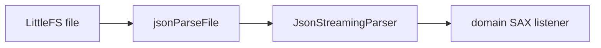

# `json`: SAX parse of LittleFS files

Streaming JSON for config and program files. No heap `String` on the parse path.

Files: `include/json/JsonParseFile.h`, `src/json/JsonParseFile.cpp`, vendored `lib/JsonStreamingParser/`.

Unknown keys are ignored (first-build). A root array at `/config.json` is a hard fail. Extra sensors/inputs/triggers beyond limits are trimmed with a log line. Soft parse of a damaged `/config.json` still loads what it can and does not rewrite the file.
