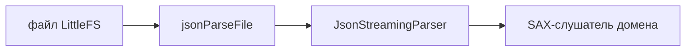

# `json`: SAX-разбор файлов LittleFS

Потоковый JSON для файлов конфига и программ. На пути разбора нет кучи `String`.

Файлы: `include/json/JsonParseFile.h`, `src/json/JsonParseFile.cpp`, вложенный `lib/JsonStreamingParser/`.

Неизвестные ключи игнорируются (первый билд). Корневой массив в `/config.json` — жёсткая ошибка. Лишние датчики, входы и триггеры сверх лимитов обрезаются, об этом пишется строка журнала. Мягкий разбор оборванного `/config.json` загружает то, что смог, и не переписывает файл. Жёсткий отказ (`failed_`, в том числе корень-массив) вызывает `Config::reset()`: `/config.json` затирается заводскими значениями, загрузка уходит в hard restart.
