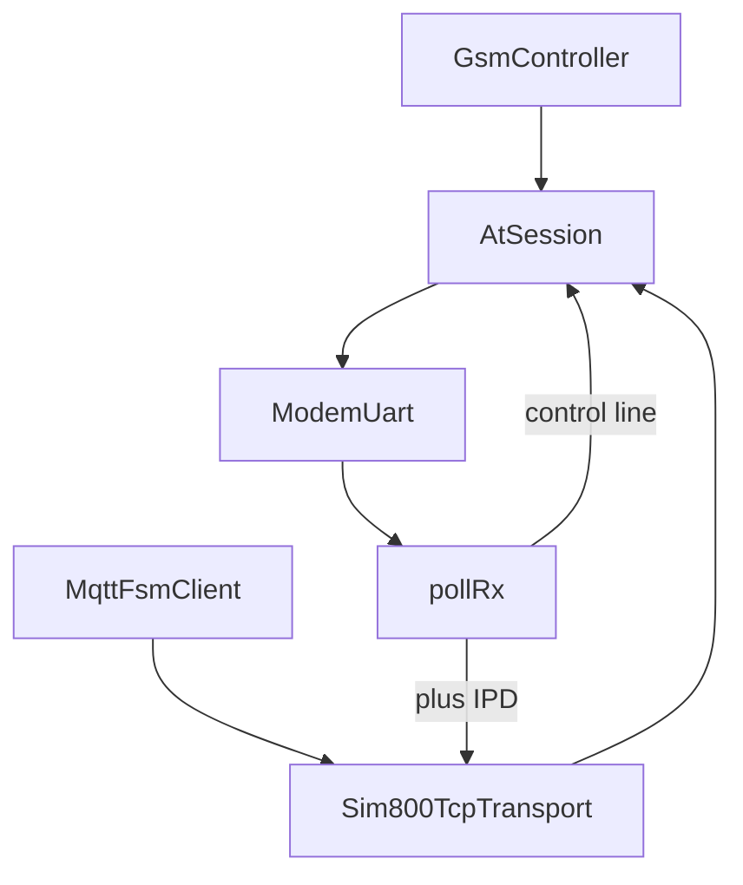
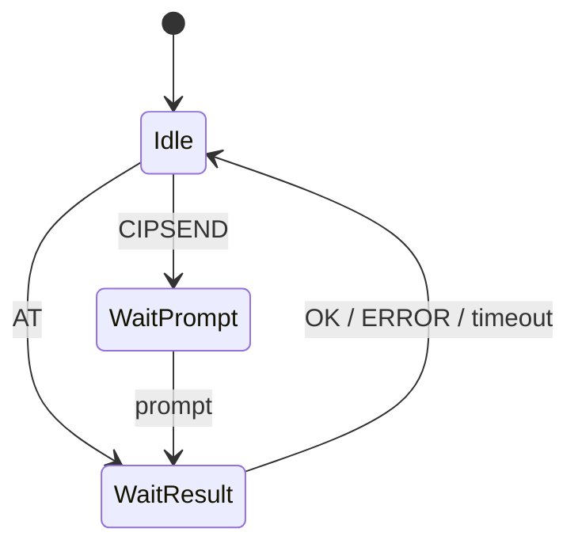

# `modem`: UART, AtSession, SIM800 TCP

Низкий слой SIM800: байтовый UART, две очереди AT, разбор `+IPD`, неблокирующий TCP `Client`.

Файлы: `include/modem/*`, `src/modem/*`, классификатор строк `Sim800Lines`.

## AtSession

Две очереди: обычная AT и приоритетная. Слот хранит копию команды (`cmdBuf`), а не указатель на общий буфер. `sendAt` ставит в очередь только если есть свободный слот; иначе вызывающий не переходит в ожидание.

## `+IPD` и TCP

`Sim800Lines` классифицирует `RDY`/`CLOSED`/`RING`/`BUSY`/`NO CARRIER`/`NO ANSWER`/`Call Ready`/`SMS Ready` по точному совпадению. Длина `+IPD` ограничена буфером TCP. `+IPD,0:` не съедает байт полезной нагрузки. `CONNECT FAIL` вызывает восстановление стека. IP-конфиг (`CIPRXGET`/`CIPHEAD`/`CIPMUX`) ставится в очередь целиком или не ставится.

Send-epoch: от `CIPSEND` до `SEND OK`/`FAIL` UART занят; MQTT не шлёт новые пакеты, пока epoch жив.
