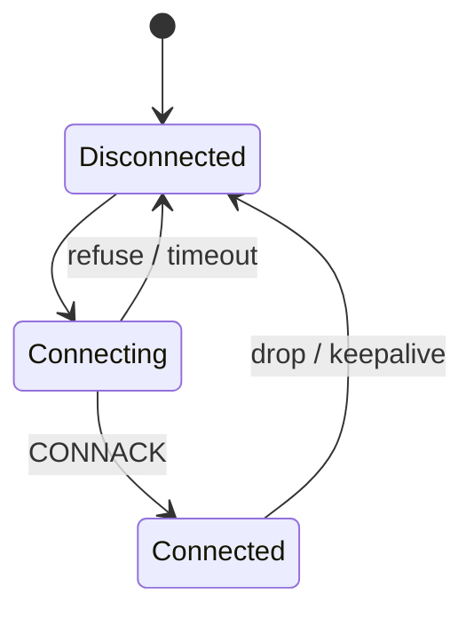

# `mqtt`: MqttFsmClient, команды и статус



## Роль
MQTT-публикация статуса и подписка на команды выполняются **встроенным неблокирующим клиентом** (`MqttFsmClient`) через обёртку `MqttClient`. Транспорт — `Client&` из GSM (SIM800 TCP).

Основные файлы:
- `include/mqtt/MqttClient.h`, `src/mqtt/MqttClient.Core.cpp`, `src/mqtt/MqttClient.Commands.cpp`
- `include/mqtt/MqttFsmClient.h`, `src/mqtt/MqttFsmClient.cpp`
- парсинг команд: `include/mqtt/MqttCommandParser.h`, `src/mqtt/MqttCommandParser.cpp`
- JSON статуса: `src/mqtt/MqttStatusBuilder.cpp`
- каталог: `src/mqtt/HwMapJson.cpp`
- лимиты cmd/reply: `MqttCmd::*` в `Constants.h`

## Контракт
### Идентификация устройства
- Устройство **идентифицируется только по топикам**.
- В payload **нет** `deviceId`/`unitId`.
- Один device = один `mqtt.topic_prefix`.
- Устройство: `cleanSession=true` (команды офлайн не копятся и не заводят машину после появления связи).

### Топики (из `mqtt.topic_prefix`)

| Суффикс | Топик | Назначение |
|---------|-------|------------|
| `/online` | `{prefix}/online` | Presence: retained `true` / `false` (LWT `false` QoS1) |
| `/state` | `{prefix}/state` | JSON телеметрия: full retained (birth/период/`status`); delta без retain (край) |
| `/programs` | `{prefix}/programs` | Retained слот = 8 hex FNV сырых файлов программ; тело по `list` с `retain=false` |
| `/hwMap` | `{prefix}/hwMap` | Retained слот = 8 hex FNV объекта карты; тело по `hwmap` с `retain=false` |
| `/trigMap` | `{prefix}/trigMap` | Retained слот = 8 hex FNV объекта триггеров; тело по `hwmap` с `retain=false` |
| `/cmd` | `{prefix}/cmd` | Команды → device (subscribe QoS1, не retained) |
| `/reply` | `{prefix}/reply` | Тонкие ответы ← device (publish QoS1) |

При смене префикса — пустой retain на старых `online`/`state`/`programs`/`hwMap`/`trigMap`.

**Offline = нет команд:** клиент шлёт `/cmd` только при `online=true`.

Кадр MQTT ≤ `MQTT_CIPSEND_MAX` (1400) байт вместе с заголовком. Буфер слота `MQTT_FRAME_MAX` (3072).

### Presence (`/online`)

- Один retained `true` после birth (после ухода полного `state` из очереди).
- Retained `false` на чистом `disconnect`.
- LWT `false`, если TCP умер. Поздний LWT может на время затереть `true`; пока устройство живо и не переподключилось, само не лечит.
- Keepalive **не** перепубликует `online=true`.

### Рождение сессии

После SUBACK, по одному кадру с ожиданием опустошения TX-очереди:

1. Три retained-хэша: `programs` → `hwMap` → `trigMap` (чистый хэш пропускается). Большие каталоги при подключении не шлём.
2. Полный retained `state` (`full:true`).
3. Только после ухода полного снимка из очереди — `online=true`.
4. Steady: край и период; при смене хэша — только retained-хэш этого топика.

### Единый `/reply`

- **Ingress**: parse + место в FIFO → ack `202` или reject. Retained на `/cmd` игнорируется. Если входящий QoS>0 и PUBACK не встал в очередь — команда не исполняется.
- **Финал**: тонкий `{id,code}`; у `status`/`seq` ещё `seq`. Жирных тел в reply нет.
- **Кольцо id (16)** только для `run`/`stop`/`set`/`set_time`: резерв на ingress до enqueue. Повтор in-flight → `202`; после финала → сохранённый `code`. Чистится при обрыве сессии.
- Исходящий reply QoS1: одна копия ≤128 B, таймаут 5 с, один DUP, затем слот свободен.

### Очереди
- Inbound FIFO `INBOUND_DEPTH=8`.
- Pending reply `PENDING_REPLY_DEPTH=4`.
- Tele: Full/Catalog липкие; Delta сливается только с Delta. Полный слот дельта не затирает.
- Период не сдвигается краем.

### Доставка `/state`

- **Период / birth / `cmd=status`**: полный снимок, `full:true`, `retain=true`, даже если байты те же.
- **Край** (`MQTT_EDGE_STATUS_GAP_MS` ≈ 250 мс): частичный JSON `full:false`, `retain=false` — только `seq` и изменившиеся ключи. Пропуск ключа = «не менялось»; `false`/`0`/`null` — значения. На стопе в дельте `program.current:null`.
- Повод края: реле, входы, двигатель; программа (старт/стоп/`current`/`last`); режим, термостат, защита АКБ, включение триггеров; напряжение ≥ 0.5 В; температура ≥ 1 °C; новая недоставленная ошибка (`err`).
- CSQ, heap, тик `epoch` и один только `timerRemaining` край не вызывают.
- `seq` с 1 на сессию; +1 при первой постановке кадра в очередь; замена неотправленного кадра сохраняет тот же `seq`. База для diff — снимок после dequeue (SEND path). Полный слот дельта не затирает.
- `sid` и `rev` в `state` нет: хэши живут в своих топиках.

### Каталог (хэш + тело)

- Retained payload на `programs` / `hwMap` / `trigMap` — ровно 8 hex-символов (свой FNV на топик). Пустой payload не слать (стирает retain). Нуль байт ввода → `811c9dc5`.
- `programs` — FNV сырых файлов программ.
- `hwMap` — FNV байт объекта карты (реле, входы, датчики, расписания).
- `trigMap` — FNV байт объекта триггеров (вход и температура).
- Смена хэша в живой сессии обновляет только retained-хэш этого топика.
- `list` → массив `[{id,name},…]` в `programs` с `retain=false`, reply `{id,code:200}` (или `422` если не влезло).
- `hwmap` → объект карты в `hwMap` и объект триггеров в `trigMap` с `retain=false`, reply `{id,code:200}`. Если один кадр не влез в 1400 — `422`; хэш неудачного топика не менять; успешный топик помечается своим новым хэшем.

### Команды (`/cmd`)

```json
{"id":"7f3a0123456789ab","cmd":"run","program":2}
{"id":"7f3a0123456789ab","cmd":"stop"}
{"id":"7f3a0123456789ab","cmd":"list"}
{"id":"7f3a0123456789ab","cmd":"status"}
{"id":"7f3a0123456789ab","cmd":"seq"}
{"id":"7f3a0123456789ab","cmd":"hwmap"}
{"id":"7f3a0123456789ab","cmd":"set","name":"thermostat","enabled":true}
{"id":"t1","cmd":"set_time","epoch":1710000000}
```

| Поле | Правило |
|------|---------|
| `id` | 1..16, `A-Za-z0-9_-` (телефон: 16 hex) |
| `cmd` | `run` \| `stop` \| `list` \| `status` \| `seq` \| `set` \| `set_time` \| `hwmap` |

| code | Смысл |
|------|--------|
| **202** | Ack: принято в FIFO |
| **200** | Успешный финал |
| **400** | parse / args |
| **404** | not found |
| **422** | rejected / catalog too large |
| **500** | авария `run` |
| **503** | inbound полна / status не встал |

- `status` — новый full retained `state`, reply `{id,code:200,seq}` (seq этого кадра).
- `seq` — **ничего не публикует** в `state`; reply `{id,code:200,seq}` = номер последнего кадра, уже ушедшего в модем (не того, что ещё в очереди).

### Снимок `state`

Корень full: `full:true`, `seq`, `uptime`, `mode`, `time` (`epoch`,`synced`,`stale`,`tz`), `io` (`voltage`,`engine`,`inputs`,`relays`,`temps` с `t`/`ok`), `csq` (число 0..31 / 99), `program`, `runtime`, `err` (omit если пуст).

Дельта: `full:false`, `seq` + изменившиеся ключи.

Лимит тела 900 байт.

### Телефон (контракт приложения)

Подписка: `online`, `state`, `programs`, `hwMap`, `trigMap`, `reply`. Пишет только в `cmd`. Свой постоянный `clientId` на установку, `cleanSession=false`.

- Пока `online` не `true` — снимок не живой; команд нет.
- При подписке сразу рисует retained-кадр и параллельно один раз шлёт `seq` (не дожидаясь ответа для первого кадра на экране). Ответ равен `seq` в этом кадре — дельт после него не было, полный `status` не нужен. Не равен — один `status`.
- `full:true` подменяет базу. `full:false` вклеивает ключи только если номер ровно следующий; дыра у уже открытого телефона — тоже один `status`. Уже открытый телефон видит реле сразу и `seq` заново не спрашивает.
- Хэш `programs` / `hwMap` / `trigMap` совпал с кэшем — тело не качает. Не совпал `programs` — один `list`. Не совпал `hwMap` или `trigMap` — один `hwmap`. Тело читает из пришедшего сообщения.
- `run`/`stop`/`set` через `online=false` сами не повторять.

### Транспорт (SIM800)
- Один MQTT-кадр = один атомарный `AT+CIPSEND`.
- RX overflow → reconnect.
- Keepalive dead-man: нет MQTT RX `1.5 × keepAliveSec` → Error.
- Ctrl serialize: ack/final ждут Ctrl-очередь и `gsm.tcpBusBusy()`.

### Time vs MQTT CIP
Полный modem cascade не делит IP с MQTT TCP. Drain: `online=false` + DISCONNECT + CIPCLOSE, затем sync, затем reconnect. См. прежние заметки в `gsm.md` / `TimeSync`.

### Вне scope
QoS2, TLS на SIM800, очередь сессий команд в прошивке, тело программы по MQTT.
