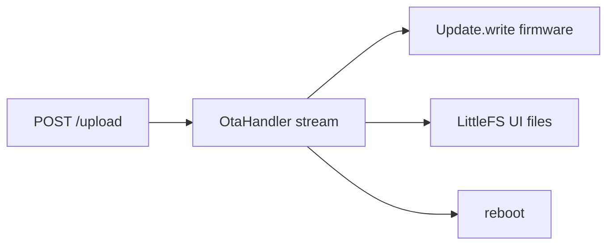

# `ota`: stream-обновление прошивки и ассетов

## Роль
`OtaHandler` принимает OTA-пакет **стримом** из `POST /upload`: чанки идут в FSM → `Update.write` (firmware) → запись UI-файлов в LittleFS.

Основные файлы:
- `include/ota/OtaHandler.h`
- `src/ota/OtaHandler.Core.cpp`, `src/ota/OtaHandler.Stream.cpp`
- upload: `src/web/WebServer.RoutesApi.cpp`

## Формат пакета (без изменений)
1) **Header (4 байта, little-endian)**: размер прошивки `fwSize` (≤ `Ota::APP_IMAGE_MAX` = `0x140000`)
2) **Firmware bytes**: `fwSize` байт → `Update.begin/write/end`
3) **Tail (опционально)**: набор файлов для LittleFS:
   - `nameLen` (2 байта LE). `0` или конец потока после fw = конец хвоста
   - `name` (`nameLen` байт)
   - `fileSize` (4 байта LE)
   - `fileData` (`fileSize` байт)

Лимит всего пакета: `Ota::FILE_MAX_SIZE` (`0x160000`). Idle без `final`: `Timing::OTA_HTTP_UPLOAD_IDLE_MS` (3 мин).

## Lifecycle

1. `POST /upload` (index=0): `prepareHttpUploadSession()` + deferred `switchMode(OTA_UPDATE)`.
2. `enterOTAUpdate`: stop программы, `relay.allOff()`, **SSE не закрывается**; GSM suspend в `handleOTAUpdate`.
3. Чанки → `streamFeed` (Update + FS на лету).
4. `final` → `streamFinish` (`Update.end`) → ответ `{"success":true,"rebooting":true}` → reboot из `OtaHandler::update`.
5. Обрыв / timeout / ошибка → `Update.abort()`, выход в NORMAL без ребута при fail upload.

## Failure-моды
- Неполный fw/хвост → abort, старый app-слот остаётся bootable (dual OTA).
- Нехватка места под UI-файл в хвосте → fail на `openWriteStream` (нужен headroom `Ota::STREAM_FS_HEADROOM`).
