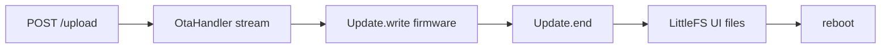

# `ota`: stream-обновление прошивки и ассетов

## Роль
`OtaHandler` принимает OTA-пакет **стримом** из `POST /upload`: чанки идут в FSM → `Update.write` (firmware) → `Update.end` → запись UI-файлов в LittleFS.

Основные файлы:
- `include/ota/OtaHandler.h`
- `src/ota/OtaHandler.Core.cpp`, `src/ota/OtaHandler.Stream.cpp`
- upload: `src/web/WebServer.RoutesApi.cpp`

## Формат пакета (без изменений)
1) **Header (4 байта, little-endian)**: размер прошивки `fwSize` (≤ `Ota::APP_IMAGE_MAX` = `0x140000`)
2) **Firmware bytes**: `fwSize` байт → `Update.begin/write`, затем сразу `Update.end(true)`.
   Сессию нельзя держать открытой до конца пакета: LittleFS на той же SPI flash не открывается, пока `Update` не закрыт.
3) **Tail (опционально)**: набор файлов для LittleFS:
   - `nameLen` (2 байта LE). `0` или конец потока после fw = конец хвоста
   - `name` (`nameLen` байт). После ведущего `/` путь — из белого списка: gzip shell (`/index.html.gz`, `/style.css.gz`, `/app.js.gz`) или схемы SoftAP (`/ui/*.ui.json`, `/validation/*.schema.json`). `build.py pack_ota` кладёт именно их.
   - `fileSize` (4 байта LE)
   - `fileData` (`fileSize` байт)
   `/config.json`, `/programs/*` и любой другой путь — отказ `failStream` (`tail path not a UI asset`)

Лимит всего пакета: `Ota::FILE_MAX_SIZE` (`0x160000`). Idle без `final`: `Timing::OTA_HTTP_UPLOAD_IDLE_MS` (3 мин).

## Lifecycle

1. `POST /upload` (index=0): `prepareHttpUploadSession()` + deferred `switchMode(OTA_UPDATE)`.
2. `enterOTAUpdate`: stop программы, `relay.allOff()`, **SSE не закрывается**; GSM suspend в `handleOTAUpdate`.
3. Чанки → `streamFeed`. По последнему байту прошивки — `Update.end(true)` (`_fwCommitted`), дальше файлы хвоста.
4. `final` → `streamFinish` (повторный `Update.end` только если сессия ещё открыта) → ответ `{"success":true,"rebooting":true}` → reboot из `OtaHandler::update`.
5. Обрыв / timeout / ошибка **до** `Update.end` → `Update.abort()`, выход в NORMAL без ребута при fail upload.
   Ошибка хвоста **после** `Update.end`: `abort` уже невозможен. Boot возвращается на выполняемый образ через `esp_ota_set_boot_partition(esp_ota_get_running_partition())`.

## Failure-моды
- Неполный fw до `end` → `Update.abort()`, старый app-слот остаётся boot.
- Хвост после `end` (обрыв, запрещённый путь, ошибка записи) → boot снова на текущую прошивку, новый слот при перезагрузке не стартует. `Update.rollBack()` в Arduino-ESP32 этого ядра (`espressif32` 6.9) выбирает следующий OTA-слот относительно boot, а не running-раздел, поэтому не используется. Обрыв питания между `end` и этим откатом всё ещё загрузит новый слот.
- Белый список хвоста: `/index.html.gz`, `/style.css.gz`, `/app.js.gz`, `/ui/settings.ui.json`, `/ui/program-steps.ui.json`, `/validation/settings.schema.json`, `/validation/program.schema.json`, `/validation/programs.index.schema.json`.
- Нехватка места под UI-файл в хвосте → fail на `openWriteStream` (нужен headroom `Ota::STREAM_FS_HEADROOM`).
