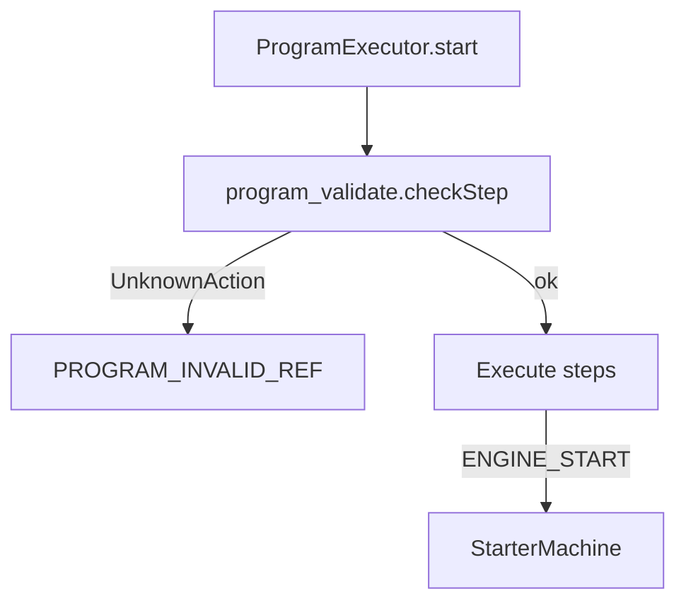

# `program`: ProgramExecutor и шаги программ

## Роль
`ProgramExecutor` исполняет сценарии (“программы”), которые состоят из шагов (`Step`) и выполняют действия
над IO и логикой устройства (реле, ожидания, проверки).

Основные файлы:
- `include/program/ProgramExecutor.h`
- `src/program/ProgramExecutor.*.cpp`
- internal: `src/program/internal/ProgramExecutorInternal.h`

## Контракты
- Исполнение программ должно быть неблокирующим (таймеры/состояния вместо долгих delay).
- Старт новой программы забирает слот у текущей: удачная передача не гасит реле (кроме работающего стартера); неудачная завершает текущую и делает `allOff()`.
- Любые операции, требующие flash, не должны выполняться во время активного выполнения программы
  (см. “deferred flash” в FS/web/core).

## Память
- Рантайм-исполнение использует **компактные шаги**: `CompiledStep` (POD, без heap).
- `CompiledStep[Limits::MAX_STEPS_PER_PROGRAM]` и `ActionId[]` — члены `ProgramExecutor`
  (фиксированные массивы, без heap и без PoolManager).
- Строковые поля шага (`action`, `message`) остаются в JSON на диске и/или в UI.
- Исключение: `CompiledStep::message` — фиксированный буфер для `SMS_OWNER` (≤64 байт; пустой текст и байты `0x1A`/`0x1B` отвергаются).

## Действия связи (v1)

| Action | Параметры | Поведение |
|--------|-----------|-----------|
| `CALL_OWNER` | нет | Набрать `gsm.owner_phone`. Гудки до ответа (`+CLCC` stat 0), `NO CARRIER`/`BUSY`/`NO ANSWER` или 25 с, затем `ATH`. OK на `ATH` — успех шага, в том числе после «занято» и «не отвечает». Провал — отказ набора, `ATD` или `ATH`; реле при этом не гасятся. MQTT CIP на эпоху выключен. Поле `ms` игнорируется. |
| `SMS_OWNER` | `message` | SMS на `owner_phone` с текстом шага, до 64 байт. |

Пустой `owner_phone` / отказ GSM → программа завершается с fail, без `allOff()`.

Остальные действия, по одной строке. Каталог и матрица реле подробнее — в [`../BEHAVIOR.md`](../BEHAVIOR.md).

| Действие | Поведение |
|---|---|
| `WAIT` | Держит `ms` |
| `RELAY_ON` / `OFF` / `TOGGLE` | Одно переключение. Реле стартера запрещено |
| `RELAY_PULSE_ON_OFF_ON` | Вкл, `ms`, выкл, `ms`, вкл |
| `RELAY_PULSE_OFF_ON_OFF` | Выкл, `ms`, вкл, `ms`, выкл |
| `INPUT_ENABLE` / `DISABLE` | Рантайм-включение входа |
| `INPUT_TRIGGER_*` / `TEMP_TRIGGER_*` | Защёлка по id. Включение взводит её, выключение сбрасывает |
| `BATTERY_SAVER_*` / `THERMOSTAT_*` | Только рантайм-флаг; ON требует device `ready` |
| `ENGINE_START` | `StarterMachine` из `config.vehicle` |

Реле: обычное завершение их оставляет. `stop()` делает `allOff()` только пока программа running; обрыв с ошибкой и неудачный `start()` — тоже `allOff()`. Удачная передача слота снимает только крутящийся стартер.

Входящий DTMF-старт (не шаг программы): см. [`gsm.md`](gsm.md) § Voice/SMS.

Неизвестная строка действия, реле вне K1–K5, любое `RELAY_*` на реле стартера, вход вне IN1–IN3, неизвестный trigger id или пустое SMS → `PROGRAM_INVALID_REF` при приёме файла и в `start()`. Прошивка не подменяет шаг и не чинит файл на LittleFS.

